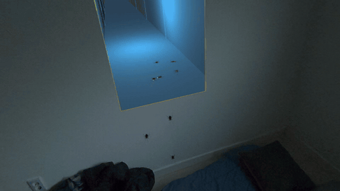

# MR Wall Portal

Quest 3 브라우저에서 도는 WebXR 작품. 패스스루로 보이는 **진짜 벽**에 포털을 걸면, 그 너머로 깊이 있는 공간이 보인다.

**데모: https://mr-wall-portal.pages.dev** — Quest 3 브라우저에서 열 것. 다른 기기에서는 "immersive-ar 미지원"만 뜬다.



> 2026-11-25 Quest 3에서 촬영한 임시 캡처다. 아래 '작업 중'에 적은 것들이
> 그 뒤로 바뀌었으므로, 작업이 끝나면 다시 찍어 교체한다.

## 작업 중 — 바퀴벌레 (`roach` 브랜치)

위 GIF에 나오는 바퀴벌레는 이 브랜치의 작업이고 아직 이 문서에 설명되어 있지
않다. 포털에서 나와 아래턱을 넘고 벽을 타고 내려와 방 바닥까지 간다.
`main`은 포털 단독으로 완결된 상태이고, 바퀴 쪽이 안정되면 합치면서 이 문서를
'포털 + 바퀴'로 다시 쓴다.

새로 들어온 것: `src/roach.ts`(몸과 걸음), `src/walk-surface.ts`(걸을 수 있는
면과 그 사이의 모서리), `src/instance-batch.ts`(부품을 조합별로 묶어 그리기),
`src/portal-crossing.ts`(포털 평면을 가로지르는 물체).

## 써 보기

1. Quest 3 브라우저에서 위 링크를 연다
2. `AR 시작` → 패스스루로 바뀐다
3. **오른손으로 벽을 가리킨다.** 파란 테두리 미리보기가 벽 위를 따라다닌다
4. **트리거를 당긴다.** 그 자리에 포털이 고정되고 테두리가 노랗게 바뀐다
5. 몸을 움직여 가며 구멍 안을 들여다본다

방을 스캔한 적이 없으면 벽이 안 잡힌다. 그때는 미리보기가 눈앞 1.5m에 떠 있고, 트리거를 당기면 거기 걸린다.

## 어떻게 동작하나

### 1. 벽 찾기

WebXR plane detection이 주는 평면을 매 프레임 받는다. 평면은 우리가 만드는 게 아니라 런타임이 방 스캔 데이터로부터 주는 것이다.

벽을 고를 때 `orientation === 'vertical'`로 거르면 **문과 창문도 같이 걸린다.** Quest는 `semanticLabel`을 채워 주므로(`wall`, `door`, `window`, `floor`, `table`, `bed` …) 그걸로 고른다. 라벨이 없는 기기를 위해 orientation 폴백이 있다.

실제로 잡힌 결과 (OculusBrowser 157, 3m × 3.16m 방):

```
평면 15개: vertical/wall ×4 (2.92~3.16m × 2.37m), vertical/door ×2,
          vertical/window, vertical/wall art ×2,
          horizontal/floor, ceiling, bed, table, shelf ×2
```

### 2. 포털 자세 잡기

오른손의 `targetRaySpace`에서 레이를 쏴 벽 메시와 교차시킨다. 손은 입력 소스 **순서**가 아니라 `handedness`로 찾는다 — 순서는 손을 보장하지 않는다.

포털을 벽에 똑바로 세울 때 벽 평면의 로컬 축을 쓰지 않는다. 평면의 로컬 좌표계는 표면이 X-Z에 눕도록 잡혀 있어 **법선은 항상 로컬 +Y**지만, 남은 X/Z 중 어느 쪽이 세로인지는 스펙이 보장하지 않는다. 그래서 월드 업과 법선으로 직교 기저를 직접 만든다.

### 3. 스텐실 포털

두 번에 나눠 그린다.

| | 하는 일 |
|---|---|
| 1. 마스크 | 포털 사각형을 `colorWrite:false`, `depthWrite:false`로 그린다 → 스텐실 버퍼에 `1`만 남는다 |
| 2. 너머 공간 | `EqualStencilFunc`로 그린다 → 스텐실이 1이 아닌 픽셀은 셰이딩 전에 폐기된다 |

복도는 **잘려 있지 않다.** 벽 뒤 실제 좌표에 9m짜리 상자가 통째로 있고, GPU는 그걸 전부 래스터화한 뒤 픽셀 단위로 버린다. 그래서 옆으로 움직이면 구멍으로 복도의 다른 부분이 보인다 — 가짜 깊이가 아니다.

**AR이라 한 단계가 빠진다.** VR에서 같은 기법을 쓰면 포털 밖에서 너머 공간을 가려 줄 가짜 벽이 필요하다. 여기서는 우리가 그리지 않은 픽셀이 투명으로 남고 컴포지터가 거기에 패스스루를 채우므로, 그 단계가 통째로 없다.

마스크의 `renderOrder`는 `-1`이다. `0`이면 기본값 `0`짜리 오브젝트를 하나 추가하는 순간 그리는 순서가 **재질을 만든 코드 순서**에 좌우된다(three.js는 `renderOrder`가 같으면 `material.id`로 정렬한다). 포털보다 앞에 있으면서 깊이를 쓰는 물체가 마스크보다 먼저 그려지면 마스크가 깊이 테스트에 떨어져 스텐실을 못 찍고, 포털이 뜯겨 나간 것처럼 보인다.

### 4. 근접 페이드

포털 평면에 얼굴을 들이밀면 세 가지가 깨진다. 카메라 near(1cm)가 마스크를 잘라 포털이 가장자리부터 뜯기고, 평면을 넘으면 백페이스 컬링으로 포털이 사라지고, 그 사이에는 눈 간격 6.4cm 때문에 **한 눈만 포털을 보는 구간**이 반드시 생긴다. 마지막 것이 사람을 멀미하게 만든다.

그 구간에 닿기 전에 30cm~8cm 사이에서 포털을 흐려 없앤다. 거리는 법선 방향 **부호 있는** 거리라, 평면을 넘어간 경우도 음수가 되어 같은 식으로 처리된다.

## 코드 구조

`src/main.ts` 한 파일, 700줄. 추상화를 일부러 미뤘다 — 전부 설명할 수 있는 것이 목표였고, 레이어를 나눌 만큼 반복되는 것이 아직 없다.

| 섹션 | 내용 |
|---|---|
| 1 | 로그 (DOM + console) |
| 2 | 렌더러 |
| 3 | 씬과 카메라 |
| 4 | 평면 감지 |
| 5 | 포털 자리 잡기 |
| 6 | 포털 너머 공간 (스텐실) |
| 7 | 렌더 루프 |
| 8 | AR 세션 진입 |
| 9 | 지원 여부 확인 |

세션에 들어가면 2D DOM은 보이지 않는다. 이 작품은 `dom-overlay`를 요청하지 않으므로, 세션 중 화면에 있는 것은 three.js가 그리는 것뿐이다. 그래서 모든 로그를 DOM과 console 양쪽에 남긴다 — DOM 쪽은 세션에서 나온 뒤에, console 쪽은 세션 중에 원격 DevTools로 읽는다.

## 기술 선택

**WebGL, WebGPU 아님.** 스텐실 버퍼를 직접 제어해야 하고, WebXR + WebGPU 조합은 아직 실험적이다. `WebGLRenderer({ stencil: true })`가 핵심인데, three.js가 이 속성을 XR 레이어까지 전달해서 `DEPTH24_STENCIL8`로 잡아 준다. 이게 없으면 기법 전체가 조용히 실패한다.

**three.js XR 애드온을 쓰지 않는다.** `ARButton`과 `XRPlanes`가 있지만, 세션 수명주기(`requestSession` → `renderer.xr.setSession` → `end`)와 평면 처리가 이 작품의 뼈대라 애드온이 숨기는 쪽이 정확히 설명이 필요한 쪽이다. `ARButton`이 끼워 넣는 종료 버튼은 Quest에서 어차피 보이지 않는다.

**`@types/three`의 `planesdetected` 이벤트 타입이 틀렸다.** payload를 `XRPlaneSet`으로 선언해 두었지만 three.js가 실제로 넘기는 것은 `XRFrame`이다(`WebXRManager.js`). 이벤트는 어차피 매 프레임 발생해 루프 대비 이득도 없어서, `setAnimationLoop((time, frame) => ...)`로 직접 받는다.

**`renderer.xr.getController(i)`를 쓰지 않는다.** `i`는 입력 소스의 순서이지 손이 아니다.

## 개발

```bash
npm install
npm run dev
```

Quest에서 보려면 보안 컨텍스트가 필요하다. `localhost`는 그 자체로 보안 컨텍스트이므로, USB로 포트를 넘기면 인증서가 필요 없다.

```bash
adb reverse tcp:5173 tcp:5173   # npm run quest 와 같다
```

헤드셋 브라우저에서 `http://localhost:5173`.

세션 중 콘솔을 보려면 Chromium 계열 브라우저에서 `chrome://inspect/#devices` → 헤드셋 탭 `inspect`. 세션 안에서는 2D UI가 보이지 않으므로 사실상 이 경로가 유일하다.

무선으로 하려면 (헤드셋을 재부팅하면 풀린다):

```bash
adb tcpip 5555
adb connect <헤드셋-IP>:5555
adb reverse tcp:5173 tcp:5173
```

### 데모 GIF 다시 만들기

헤드셋에서 녹화한 뒤 `adb pull /sdcard/Oculus/VideoShots/<파일>.mp4`로 가져와서:

```bash
ffmpeg -ss <시작초> -t 8 -i <녹화>.mp4 -vf "fps=8,scale=480:-1:flags=lanczos,palettegen=stats_mode=diff:max_colors=128" palette.png
ffmpeg -ss <시작초> -t 8 -i <녹화>.mp4 -i palette.png -lavfi "fps=8,scale=480:-1:flags=lanczos[x];[x][1:v]paletteuse=dither=bayer:bayer_scale=4" docs/demo.gif
```

480px · 8fps · 8초면 3.5MB쯤 나온다. 더 키우면 저장소에 넣기 부담스러워진다 —
패스스루 영상은 노이즈가 많아 GIF로 잘 줄지 않는다. 원본 mp4는 저장소에 넣지
않는다.

## 배포

```bash
npm run deploy
```

Cloudflare Pages. wrangler는 devDependency가 아니라 npx로 부른다 — 의존성으로 설치하면 자기 자신과 `@cloudflare/vite-plugin`을 `package.json`에 추가하고 `vite.config.ts`를 Workers 방식으로 고치려 든다. 이 프로젝트는 평범한 정적 번들이다.

`--branch`를 바꾸면 프로덕션을 건드리지 않고 미리보기 URL로 올라간다. 헤드셋에서 실험할 때 쓴다.

## 범위 밖

의도적으로 넣지 않은 것들:

- **포털 통과** — AR에서는 뒤집기가 오히려 쉽다(`NotEqualStencilFunc`로 구멍만 비우면 패스스루가 돌아온 쪽을 공짜로 보여 준다). 진짜 장애물은 코드가 아니라 물리적인 벽이다. 통과하려면 포털을 허공이나 문간에 놓아야 하고, 그러면 "벽에 걸린 포털"이라는 설정 자체가 바뀐다
- 포털 여러 개, 사운드, 서사, 손으로 벽을 문질러 뚫기

## 확인된 환경

Quest 3 / OculusBrowser 157. 런타임이 허용한 기능:

```
local, viewer, plane-detection, anchors, webxr, hit-test, local-floor
```
